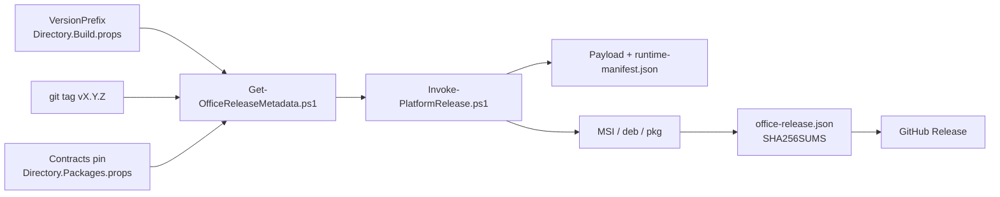

# 60 · Release

**Audience:** release engineers, and contributors preparing a tagged version. Operators who are installing or
upgrading an Office should read `docs/40-operations/` instead.

Office is an independently versioned installable deliverable. The default version-driven workflow builds
[GitHub-hosted development bundles](07-hosted-development-bundles.md) without production signing
keys. Push a `VersionPrefix` bump and matching release notes to `main`; the workflow creates the
tag and release automatically. The destination host performs certification and development signing
before installation.
The separate, manually dispatched production workflow packages signed installers on hardened runners.

### Build installers for a platform trial

In Office Actions, open **signed-release**, select **Run workflow** on `main`, and check **Build signed test installers for all platforms and keep them as workflow artifacts** (`package_only`). The signing runners need their usual platform credentials and certification evidence. When the `verify` job succeeds, download `release-windows-x64`, `release-linux-x64`, `release-linux-arm64`, `release-macos-x64`, or `release-macos-arm64` from the run. `release-metadata` contains the consolidated checksums and manifest. The publish job is skipped. The Windows development bundle has a separate workflow and release channel. Verified: 2026-11-24 against [signed-release](../../.github/workflows/release.yml) and [hosted-development-release](../../.github/workflows/hosted-release.yml).

For an unpublished Windows candidate, extract the MSI and every CAB into the same directory and open the MSI. To exercise the signed Setup EXE before its public downloads exist, put those same files in `%LOCALAPPDATA%\CSweet\Downloads\<version>` and open the EXE. It verifies each cached file against its embedded digest. After publication, test Setup once more on a clean computer to cover the public download. Verified: 2026-11-24 against [OfficeSetup.Run](../../scripts/windows/OfficeSetup.cs).

Production signing and certification remain restricted to hardened workflows. Hosted development
bundles are explicitly labeled and are not represented as production-signed or CI-certified.

| Page | Covers |
|---|---|
| [01-versioning-and-compatibility.md](01-versioning-and-compatibility.md) | The three version truths, the script that enforces agreement, and the contracts compatibility rule. |
| [02-payload-and-manifest.md](02-payload-and-manifest.md) | What a payload contains on each platform, and what `runtime-manifest.json` binds. |
| [03-certification.md](03-certification.md) | What the smoke paths verify, the evidence file shape, and the development signers. |
| [04-release-pipeline.md](04-release-pipeline.md) | `ci.yml` and `release.yml`: triggers, runners, environments, secrets, and stages. |
| [05-signing-and-provenance.md](05-signing-and-provenance.md) | Per-platform signing, the SBOM, provenance attestation, and the release manifest. |
| [06-release-notes-process.md](06-release-notes-process.md) | The `releases/*.md` convention, with 0.4.0 through 0.5.3 as a worked example. |

## Production installer pipeline

Certification happens before `Invoke-PlatformRelease.ps1` on the hardened runner. The script consumes the
certified guest image, its signature, the signing certificate, and the certification evidence as protected
environment variables and fails immediately when any of them is absent. See [03-certification.md](03-certification.md).

Windows, Linux and macOS take the suite and certification times from the runner's evidence.
`Get-OfficeReleaseCertification.ps1` also checks that its expiry matches the protected release setting.
`ExternalPlatformIsolationBackend.VerifyCertificationEvidenceAsync` checks these values again on the Office.
Verified: 2026-11-24.

## The two rules that shape everything here

- **The tag must equal the source.** `Get-OfficeReleaseMetadata.ps1` refuses a tag that does not name the
  `VersionPrefix` in `Directory.Build.props`. There is no override. See
  [01-versioning-and-compatibility.md](01-versioning-and-compatibility.md).
- **Assets are immutable and canonical on GitHub Releases.** `c-sweet.com` links to those assets; Office never
  self-updates. See [05-signing-and-provenance.md](05-signing-and-provenance.md).

## Sources

`AGENTS.md`, `README.md`, `.github/workflows/{ci.yml,release.yml,hosted-release.yml}`, `scripts/release/*`, `release/office-release.schema.json`.

Verified: 2026-09-19.
